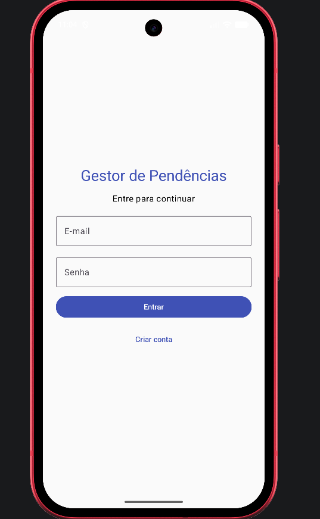
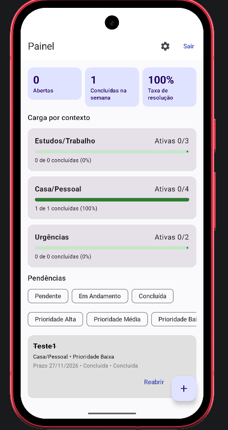
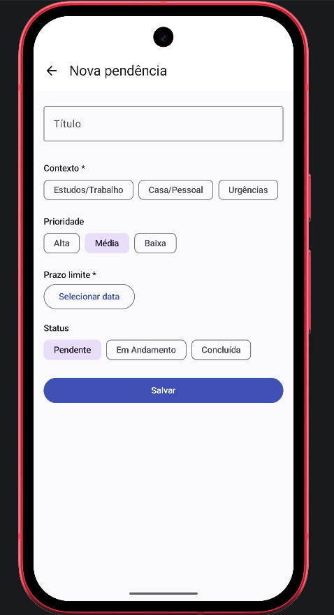

# Gestor de Pendências e Prioridades por Contexto

**Aluno:** Paulo Henrique Marques Silva  
**Curso:** Análise e Desenvolvimento de Sistemas, IFTM Campus Patrocínio  
**Disciplina:** Programação Para Dispositivos Móveis. **Atividade:** Prova 07

Aplicativo Android (Kotlin + Jetpack Compose) para organizar pendências diárias com **limite de trabalho em andamento (WIP limit) por contexto**, autenticação via Firebase e persistência local com Room.

## Links

| Entrega | Link |
|---|---|
| Protótipo no Figma | _COLE_AQUI_O_LINK_PUBLICO_ |
| Vídeo demonstrativo | https://youtu.be/o5Kehb8TZm4 |

## Capturas de tela

| Login/Cadastro | Painel | Nova/Editar pendência |
|---|---|---|
|  |  |  |

## Funcionalidades

1. **Capacidade por contexto**: limite de pendências ativas (Pendente + Em Andamento) para *Estudos/Trabalho* (padrão 3), *Casa/Pessoal* (4) e *Urgências* (2). Editável no ícone de engrenagem do Painel.
2. **Cadastro rápido**: título, contexto (obrigatório), prioridade (Alta/Média/Baixa), prazo e status (Pendente/Em Andamento/Concluída). O WIP limit é verificado ao criar, editar e avançar o status.
3. **Painel em tempo real**: barra de progresso por contexto (% concluídas) e alertas cromáticos: 🟢 no prazo, 🟡 vence em até 2 dias, 🔴 atrasada.
4. **Resumo global**: pendências abertas, concluídas na semana (últimos 7 dias) e taxa de resolução.
5. **Validação e persistência**: título vazio ou curto, prazo ausente ou no passado e limites fora de 1 a 20 são rejeitados. Dados em Room, com filtros por status e prioridade.
6. **Autenticação**: cadastro e login com e-mail/senha (Firebase Authentication).

## Arquitetura (MVVM)

```
UI (Compose)  ──eventos──▶  ViewModel  ──▶  Repository  ──▶  Room (DAO)
   ▲                           │
   └────── StateFlow<UiState> ◀┘
```

| Camada | Arquivos | Responsabilidade |
|---|---|---|
| **Model** | `data/Model.kt`, `data/Database.kt`, `data/PendenciaRepository.kt` | Entidades Room, DAO, regra do WIP limit |
| **ViewModel** | `AuthViewModel`, `HomeViewModel`, `FormViewModel` | Estado reativo (`StateFlow`), validação, cálculo dos indicadores |
| **View** | `AuthScreen`, `HomeScreen`, `FormScreen`, `AppNav` | Composables sem regra de negócio, apenas renderizam o `UiState` |
| **Util** | `util/Validacao.kt`, `util/Datas.kt` | Validações puras (testadas) e cálculo de urgência |

- Cada usuário (`uid` do Firebase) só enxerga as próprias pendências e limites.
- Prazos são armazenados como `epochDay`, evitando problemas de fuso horário.
- Testes unitários: `app/src/test/.../ValidacaoTest.kt`.

## Como executar

1. Abra a pasta no **Android Studio** (Ladybug ou mais recente) e aguarde o Gradle Sync.
2. No [Console do Firebase](https://console.firebase.google.com), crie um projeto, adicione um app Android com o pacote `br.edu.iftm.gestorpendencias` e ative **Authentication > E-mail/senha**.
3. Baixe o `google-services.json` e coloque em `app/` (o arquivo está no `.gitignore`).
4. Execute em um emulador ou dispositivo (minSdk 26).

## Tecnologias

Kotlin 2.0, Jetpack Compose + Material 3, Navigation Compose, Room, Firebase Authentication, Coroutines/Flow.
